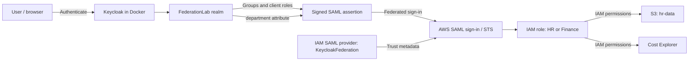

# Keycloak + AWS IAM SAML Federation Lab

An existing hands-on identity lab by Derrick demonstrating AWS IAM federation through a Docker-hosted Keycloak identity provider. The exercises explore group-based role assignments (RBAC), department-based session attributes (ABAC), IAM permissions, and authentication and authorization testing.

**Existing image:** [derricksh43/keycloak-federation-lab on Docker Hub](https://hub.docker.com/r/derricksh43/keycloak-federation-lab)

This repository documents the previously built lab; it does not rebuild the image or supply new infrastructure. The walkthrough and expected outcomes come from the author's [original lab document](https://docs.google.com/document/d/1QRCpaiJQ4n11CUeUFu9pArDcwwZkvB55y1zq-_1R8YI/edit). Deployment and access tests were **not independently rerun** for this publication. Reproducibility limitations are identified below rather than presented as verified behavior.

## At a glance

| Technology / skill | Lab activity |
| --- | --- |
| Keycloak | Realm, SAML client, users, groups, client roles, and attribute mappers |
| AWS IAM and SAML 2.0 | Identity provider metadata, federated roles, role ARN mappings, and console federation |
| RBAC | Map `hr` and `finance` group membership to AWS roles |
| ABAC | Map `department` to a SAML principal tag and evaluate a conditional IAM policy |
| IAM authorization | Compare S3 read access with Cost Explorer API permissions |
| Docker | Deploy the existing preconfigured identity provider image |
| Testing | Compare intended allow/deny outcomes and investigate federation or permission failures |

## Architecture and federation flow



1. Keycloak authenticates a user in the `FederationLab` realm.
2. Group membership or direct client-role assignment selects the lab's `HR` or `Finance` role mapping.
3. The SAML assertion carries the AWS role/provider ARN pair and a role session name. For ABAC, it also carries `department` as a principal-tag attribute.
4. AWS validates the assertion against the configured IAM SAML provider and role trust, then establishes a temporary role session.
5. IAM evaluates the role's policies for each resource request. The ABAC example checks `aws:PrincipalTag/department`.

Authentication establishes the user's identity; the assumed role's effective permissions determine authorization.

## Prerequisites and lab boundaries

- Docker installed and running; the source guide expects Docker 20.10.0 or later.
- An AWS account with administrative access for the setup steps, plus a browser and terminal.
- Your 12-digit AWS account ID, substituted for every `<ACCOUNT_ID>` below.
- An existing S3 bucket for the S3 exercises. The source uses `hr-data`; that name must refer to a bucket you control. If using a different name, update both bucket and object ARNs in the example policies. Bucket creation is not included in the source walkthrough.
- Cost Explorer access and available cost data for the Finance exercise. The policy grants only the two listed API actions; a complete console experience can require additional permissions or account settings.

Use an isolated lab environment. The source's example user password, `password123`, is **lab-only**, publicly documented, and unsuitable for real accounts. Example emails use `example.com`; `<ACCOUNT_ID>` and `YourCustomPassword` are placeholders. Use a unique admin password and restrict access to trusted networks. Do not commit real credentials, metadata exports, assertion captures, or account-specific configuration.

The image version, preconfigured contents, and runtime behavior were not independently inspected. Console labels can vary by installed version.

## 1. Docker quick start

Check Docker, then pull the existing image:

```sh
docker --version
docker pull derricksh43/keycloak-federation-lab:latest
```

Run this single-line command in PowerShell, Command Prompt, or a POSIX shell. Replace `YourCustomPassword` before execution:

```sh
docker run -p 8080:8080 -e KEYCLOAK_ADMIN=admin -e KEYCLOAK_ADMIN_PASSWORD=YourCustomPassword derricksh43/keycloak-federation-lab:latest
```

This preserves the source's environment variables and image invocation. Port `8080` is published on the host; restrict host/network access as appropriate for the lab. The source provides no volume or persistence configuration.

Wait for the startup logs. Open [http://localhost:8080](http://localhost:8080), choose **Administration Console**, and sign in as `admin` with the password you supplied. Select **FederationLab** from the realm selector.

### Preconfigured settings documented by the author

| Item | Documented value |
| --- | --- |
| Realm | `FederationLab` |
| SAML client label used in the guide | `aws-saml-client` |
| SAML client ID / entity ID | `urn:amazon:webservices` |
| Client settings | Sign assertions; POST binding enabled |
| Existing mappers | `Role` and `RoleSessionName` |
| Role attribute | `https://aws.amazon.com/SAML/Attributes/Role` |
| Session-name attribute | `https://aws.amazon.com/SAML/Attributes/RoleSessionName` |
| Existing groups | `hr`, `finance`, `security`, `devops` |

The exercises use only `hr` and `finance`. In the steps below, select the SAML client identified by `urn:amazon:webservices` if the console displays its ID instead of the guide's label.

## 2. Configure the AWS IAM SAML provider

1. Sign in to the AWS Management Console. Open the account menu, then **My Account / Account settings**, and find the 12-digit account ID. Use it for `<ACCOUNT_ID>`.
2. In Keycloak's `FederationLab` realm, open **Realm settings → General → SAML 2.0 Identity Provider Metadata**. The source metadata URL is:

   ```text
   http://localhost:8080/realms/FederationLab/protocol/saml/descriptor
   ```

3. Save the XML as `keycloak-saml-metadata.xml` locally; do not add it to this repository.
4. In AWS, open **IAM → Identity providers → Add provider**.
5. Choose **SAML**, name the provider `KeycloakFederation`, and upload the metadata XML.
6. Create the provider and confirm its ARN:

   ```text
   arn:aws:iam::<ACCOUNT_ID>:saml-provider/KeycloakFederation
   ```

## 3. RBAC walkthrough: HR and Finance

### Create the AWS roles

1. Open **IAM → Roles → Create role**.
2. Choose **SAML 2.0 federation**, select `KeycloakFederation`, and select **Allow programmatic and AWS Management Console access**.
3. Continue without adding permissions yet; name the role `HR` and create it.
4. Repeat for `Finance`.

The resulting role ARNs are:

```text
arn:aws:iam::<ACCOUNT_ID>:role/HR
arn:aws:iam::<ACCOUNT_ID>:role/Finance
```

The source relies on the console's SAML role-creation workflow and does not include an exported trust policy. Inspect the resulting trust relationship when diagnosing federation failures.

### Create and attach the permission policies

For each policy, open **IAM → Policies → Create policy → JSON**, paste the corresponding example, and save it under the listed name. Then open **Roles → the target role → Add permissions → Attach policies** and attach it.

**HRPolicy → HR** — [policies/HRPolicy.json](policies/HRPolicy.json):

```json
{
  "Version": "2012-10-17",
  "Statement": [
    {
      "Effect": "Allow",
      "Action": ["s3:GetObject", "s3:ListBucket"],
      "Resource": ["arn:aws:s3:::hr-data/*", "arn:aws:s3:::hr-data"]
    }
  ]
}
```

This permits listing the named bucket and reading its objects. It does not grant general S3 administration or listing every bucket in the console.

**FinancePolicy → Finance** — [policies/FinancePolicy.json](policies/FinancePolicy.json):

```json
{
  "Version": "2012-10-17",
  "Statement": [
    {
      "Effect": "Allow",
      "Action": ["ce:GetCostAndUsage", "ce:GetCostForecast"],
      "Resource": "*"
    }
  ]
}
```

### Create the Keycloak users

In `FederationLab`, open **Users → Add user** for each entry:

| Username | Email | First name | Last name | Group |
| --- | --- | --- | --- | --- |
| `hr.jane` | `jane@example.com` | Jane | HR | `hr` |
| `finance.john` | `john@example.com` | John | Finance | `finance` |

For each user:

1. Create the user, then open **Credentials → Set password**.
2. The source uses `password123` for both password fields; this is a **lab-only example**. Clear **Temporary** and save.
3. Open **Groups → Join group** and join the group listed above.

### Create client roles and map them to groups

1. Open **Clients → aws-saml-client → Roles → Create role**.
2. Create `HR`, with description `Maps to AWS HR role`.
3. Create `Finance`, with description `Maps to AWS Finance role`.
4. Open **Groups → hr → Role mappings → Assign role**. Filter for client roles belonging to `aws-saml-client`; select `HR` and assign it.
5. Repeat for group `finance`, assigning client role `Finance`.

### Add the AWS ARN attributes

In **Clients → aws-saml-client → Roles**, open each role's **Attributes** tab and add:

**HR**

```text
Key:   https://aws.amazon.com/SAML/Attributes/Role
Value: arn:aws:iam::<ACCOUNT_ID>:role/HR,arn:aws:iam::<ACCOUNT_ID>:saml-provider/KeycloakFederation
```

**Finance**

```text
Key:   https://aws.amazon.com/SAML/Attributes/Role
Value: arn:aws:iam::<ACCOUNT_ID>:role/Finance,arn:aws:iam::<ACCOUNT_ID>:saml-provider/KeycloakFederation
```

Save each attribute. The source documents these role attributes and a preconfigured `Role` mapper, but does not provide that mapper's full settings. Verify the emitted assertion actually contains the ARN pair; storing a role attribute alone does not establish that the mapper emits it.

### Exercise the RBAC flow

The original guide starts sign-in at:

```text
http://localhost:8080/realms/FederationLab/protocol/saml
```

**Reproducibility limitation:** this is the realm's SAML protocol endpoint. The source does not document an initiated SAML request, client-specific IdP-initiated login URL, or complete AWS destination/ACS settings. Opening the endpoint directly may fail rather than display a login page. Use the existing image's configured login flow if available; this repository does not invent replacement settings. A successful AWS redirect is a documented expectation, not a verified result of visiting this URL.

Once the existing federation flow is available:

1. Sign in as `hr.jane` with the lab password. Attempt to list/read the `hr-data` bucket and view Cost Explorer.
2. Sign out of both AWS and Keycloak, or use a fresh browser session.
3. Repeat as `finance.john`.
4. Compare the results against the expected-results table below.

## 4. ABAC walkthrough: department attribute

### Create the conditional IAM policy

Use **IAM → Policies → Create policy → JSON**, create `HRABACPolicy` from [policies/HRABACPolicy.json](policies/HRABACPolicy.json), and attach it to `HR` as directed in the original exercise:

```json
{
  "Version": "2012-10-17",
  "Statement": [
    {
      "Effect": "Allow",
      "Action": ["s3:GetObject", "s3:ListBucket"],
      "Resource": ["arn:aws:s3:::hr-data/*", "arn:aws:s3:::hr-data"],
      "Condition": {
        "StringEquals": {
          "aws:PrincipalTag/department": "HR"
        }
      }
    }
  ]
}
```

**Policy interaction in the source:** the RBAC steps already attach unconditional `HRPolicy` to the same role. Adding `HRABACPolicy` does not remove that existing allow. With both attached, changing `department` to `Finance` will not by itself deny the S3 actions. The source's negative ABAC test requires the conditional policy to be the applicable grant without the earlier unconditional grant or another permission allowing access. The original attachment steps are retained here; no replacement policy or role design is supplied. See [AWS policy evaluation logic](https://docs.aws.amazon.com/IAM/latest/UserGuide/reference_policies_evaluation-logic.html).

### Create and configure Alice

1. In Keycloak, open **Users → Add user** and create:

   | Username | Email | First name | Last name |
   | --- | --- | --- | --- |
   | `hr.alice` | `alice@example.com` | Alice | HR |

2. Set a password under **Credentials**; the source uses lab-only `password123`. Clear **Temporary** and save.
3. Open **Attributes → Add attribute**. Set key `department`, value `HR`, and save.
4. Open **Client scopes → aws-saml-client-dedicated → Mappers → Create**. Depending on the console version, the dedicated scope may be accessed through the client's scopes view.
5. Configure and save the mapper:

   | Field | Value |
   | --- | --- |
   | Name | `department` |
   | Mapper type | `User Attribute` |
   | User attribute | `department` |
   | SAML Attribute Name | `https://aws.amazon.com/SAML/Attributes/PrincipalTag:department` |
   | SAML Attribute NameFormat | `Basic` |

6. Open **Users → hr.alice → Role mappings → Assign role**. Filter client roles for `aws-saml-client`, select `HR`, and assign it.

**Session-tag prerequisite omitted from the original steps:** AWS requires `sts:TagSession` in the relevant role trust policy to accept session tags. The source does not show whether the existing role trust includes this permission. Inspect the trust policy and assertion before treating the ABAC exercise as runnable; no new trust-policy example has been added. See [AWS session tags](https://docs.aws.amazon.com/IAM/latest/UserGuide/id_session-tags.html).

### Exercise the ABAC flow

1. Use the existing configured SAML sign-in flow, subject to the login limitation described above, and sign in as `hr.alice`.
2. Attempt to list/read `hr-data`; the source expects access with `department=HR`.
3. In Keycloak, change Alice's `department` to `Finance` and save.
4. End the prior AWS and Keycloak sessions and sign in again so a new assertion and role session carry the updated value.
5. Repeat the S3 operation. The source expects denial, subject to the policy-interaction and session-tag prerequisites above. Editing Keycloak does not change tags in an already-issued AWS session.

## 5. Bonus exercise: compare RBAC and ABAC

Create two users through **Users → Add user**:

| Username | Email | First / last name | Configuration |
| --- | --- | --- | --- |
| `rbac.test` | `rbac@example.com` | Test / RBAC | Join `hr`; assign client role `HR` directly as also specified in the source |
| `abac.test` | `abac@example.com` | Test / ABAC | Set `department=HR`; assign client role `HR` directly |

For both users, use **Credentials** to set the lab-only example password `password123`, with **Temporary** cleared. Join groups through **Groups → Join group** and assign roles through **Role mappings → Assign role → client roles → aws-saml-client → HR**. Set attributes through the user's **Attributes** tab.

1. Sign in as `rbac.test` through the existing federation flow and attempt S3 list/get access to `hr-data`.
2. End the sessions, sign in as `abac.test`, and repeat.
3. Change `abac.test`'s `department` to `Finance`, end the sessions, sign in again, and repeat.
4. Compare group-driven assignment with attribute-conditioned authorization.

The source intends both users to have initial access, followed by denial only for the changed ABAC user. Both users assume the same `HR` role, so the same IAM policies apply to both: the original combined-policy configuration cannot independently demonstrate that distinction. Also, the direct `HR` assignment on `rbac.test` duplicates its group-derived assignment, so this exercise does not isolate group inheritance. These are limitations of the documented comparison, not independently verified outcomes.

## Expected test results and verification status

All results below are **expected results from the source**, not recorded execution evidence. This publication verified documentation structure and JSON consistency only; it did not run Docker, authenticate through Keycloak, or make AWS authorization requests.

| Test | Source's expected result | Interpretation / prerequisite |
| --- | --- | --- |
| Container and admin login | Keycloak dashboard; `FederationLab` available | Image runtime and bootstrap behavior not rerun |
| Federated sign-in | Redirect to AWS Console | Existing client login, assertion mappers, and IAM trust must be valid |
| `hr.jane` → `hr-data` list/get | Allow | Bucket exists, correct ARNs, no overriding restrictions |
| `hr.jane` → Cost Explorer | Deny | No other applicable permission grants access |
| `finance.john` → cost data | Allow | Two documented API actions; console and account prerequisites may apply |
| `finance.john` → `hr-data` | Deny | No other applicable permission grants access |
| `hr.alice`, `department=HR` → S3 | Allow | Valid principal tag and applicable conditional grant |
| `hr.alice`, changed to `Finance` → S3 | Deny | Not achieved merely by adding ABAC policy alongside unconditional HR policy |
| Bonus: both users initially → S3 | Allow | Source expectation; shared-role policy limitations apply |
| Bonus: changed `abac.test` → S3 | Deny | Same shared-role and unconditional-grant caveats apply |

This is an existing educational lab, not a claim of production deployment or independently validated end-to-end operation.

## Troubleshooting

| Symptom | Checks |
| --- | --- |
| Keycloak is unavailable | Confirm Docker is running, port 8080 is available, and startup completed. Find the container with `docker ps -a`; inspect `docker logs <container_id>`. |
| Admin login fails | Confirm the password supplied at launch and inspect image logs. The source does not specify the image's Keycloak version or whether bootstrap variables affect an already-initialized admin. |
| SAML endpoint reports an error | Check the existing client's actual sign-in flow and destination settings. The bare realm protocol endpoint is not a complete documented login flow. |
| AWS rejects the assertion | Check Keycloak logs, available AWS CloudTrail events, provider metadata, account ID, role/provider ARNs, and the role trust relationship. |
| Role is absent or invalid | Inspect the assertion's `https://aws.amazon.com/SAML/Attributes/Role` value. Confirm group membership, client-role assignments, and actual mapper output. Use the source's “Test SAML Login” option only if available in the installed console. |
| ABAC session creation fails | Check that the assertion carries the principal-tag attribute and the relevant role trust permits `sts:TagSession`. |
| ABAC still allows access after changing department | Start a fresh AWS session and inspect effective policies. An unconditional `HRPolicy` grant still permits these actions even if the ABAC condition is false. |
| S3 console fails to list buckets | The HR examples allow access to the named bucket, not listing all buckets. Distinguish console navigation failures from the specific `ListBucket` / `GetObject` tests. |
| Expected permissions do not match results | Use AWS IAM Policy Simulator to inspect policy behavior; check other policies, bucket permissions, boundaries, and account restrictions. Simulation is not a substitute for a real federation test. |

## Repository contents and license

- `README.md`: consolidated source walkthrough, expected results, and documented limitations.
- `policies/HRPolicy.json`, `policies/FinancePolicy.json`, `policies/HRABACPolicy.json`: the three IAM examples from the source, with formatting cleaned up and valid JSON syntax.
- `.gitignore`: excludes common credential files and local lab exports.
- `LICENSE`: MIT license for this repository's documentation and examples. The existing Docker image and its bundled software retain their own licenses; this repository does not relicense them.

The original guide remains the source of truth for the lab steps. AWS references above explain identified prerequisites and policy semantics; they are not evidence of new deployment or testing.
